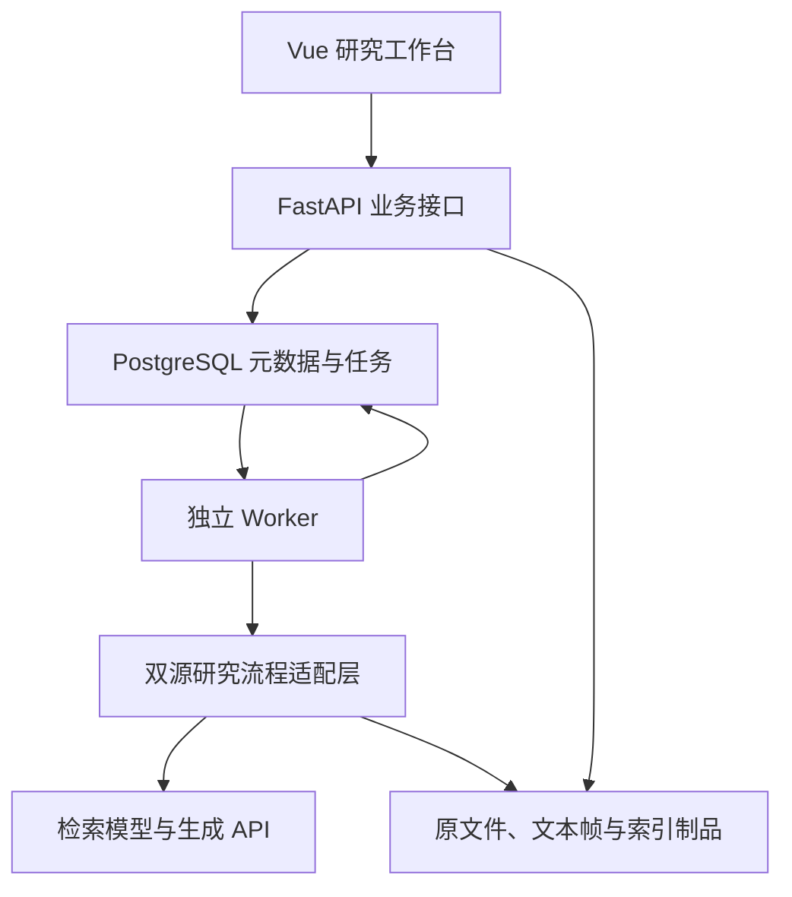

# 需求范围与架构设计

状态：阶段 1 设计基线；日期：2026-10-26。

## 已确认需求

| 编号 | 需求 | 设计响应 |
| --- | --- | --- |
| R01 | 论文答辩完整系统 | 公司、双源文档、评价任务、证据、可视化及报告闭环 |
| R02 | 第四章参考小论文 | 以跨年与 Agent 实跑修订稿及实际代码为依据 |
| R03 | 第三章稍后加入已有结果 | 保留指数结果引用及导入接口，不实现或替代其研究方法 |
| R04 | 本地与服务器均支持 | 相同业务服务，两种配置，检索模型可本地或远程提供 |
| R05 | 复用 xiaolun | 复用真实语料、0.6B 模型与运行配置，设置适配层 |
| R06 | 重要内容同步 GitHub | 需求、设计、代码、验证摘要按工作包提交 |

默认面向一名研究人员及答辩演示，预置可信的研究数据。首版不扩展为生产监管平台，也不实现多租户、复杂审批或多智能体协作。服务器默认在受控网络演示；如需公开访问，再加入登录与部署保护工作包。

## 业务主线

1. 选择公司与年度，上传或导入身份明确的完整年报；法规作为独立资料库登记版本。
2. 解析生成文本帧、位置片段及索引；显示解析失败、OCR 待核实、选页导入等状态。
3. 创建单问题评价或四维评价任务。四维任务来自版本化问题模板，每维可含多题。
4. 年报候选严格限定公司与年度；法规候选独立检索，时点筛选仅在显式指定事项日期及策略时启用。
5. 预算内按完整片段组装两类证据，生成评价与引用。记录实际输入、输出和不足说明。
6. 用户在评价正文中点选引用，查看原文、物理页、法规版本与来源状态。
7. 汇总四维结论并导出报告。第三章结果未接入时显示“指数结果未接入”。

四维覆盖 D1 信息披露质量、D2 董事会治理有效性、D3 内部控制与合规性、D4 第三方声誉。仅靠年报无法完整观察的事项应显示资料不足，尤其不能用年报中缺失的第三方信息推断声誉差。

## 架构决策

### ADR01 保留现有 Web 框架

保留 Vue3、Element Plus、ECharts、FastAPI 和 SQLAlchemy。改造业务模型与流程，而非另起技术栈。现有服务按领域拆分为 document、index、retrieval、evaluation、task、export；控制层不执行长耗时模型操作。

### ADR02 先复用已验证的索引制品

首个可运行版本在 Windows 和服务器均采用研究原型的可校验索引制品后端，减少同时迁移模型、排序和向量存储造成的差异。PostgreSQL 保存业务身份与制品清单，不保存 GPU 模型。

定义 VectorIndex 接口，支持检索作用域、模型身份、片段身份和索引版本。Milvus 作为后续可选后端，须完成片段逐一映射、过滤一致性与可解释排序差异验证后启用。不能把旧 BGE 集合直接改名当成 Qwen 索引。

### ADR03 长任务在独立进程执行

PostgreSQL 任务表配合 Worker 领取、租约、心跳和有限重试；首版无需增加 Redis。领取采用事务及 SKIP LOCKED，任务领取事务在实际计算前结束。GPU 初始并发为 1，可配置；持久化任务不会因为浏览器关闭而消失。

外部 API 可能已计费但没有收到响应，因此采用至少一次任务投递、幂等持久化和独立调用 attempt 记录，不承诺外部 API 恰好调用一次。取消在当前调用结束后生效；超时或进程中断的调用标记 unknown_outcome。

### ADR04 固定双源与 Agent 分开

固定双源为默认。工具 Agent 的规划、补检索、核验、修订是可选模式，每轮保存工具参数、加入证据、耗时及预算。调用上限、补检索次数、tokens 上限和超时为硬限制；预算耗尽必须形成明确终态，不自动无限重试。

### ADR05 证据追溯分层

“检索命中”“进入上下文”“正文引用”“模型判断支持”“人工复核支持”分别记录。模型自报 supported 不等于人工确认。检索分数不表示法规适用性；未知版本和事项日期保留未知，报告年度不替代事项日期。

### ADR06 配置和部署

| 配置 | Windows 本地 | 服务器 |
| --- | --- | --- |
| Web | Vite 开发代理或构建后 Nginx | Nginx 同源代理及 SPA 回退 |
| 业务库 | Docker PostgreSQL 或已配置实例 | PostgreSQL 持久卷 |
| Worker | 独立 Python 进程，绝对配置路径 | 独立服务，健康与租约监测 |
| 检索模型 | 既有隔离 CUDA 环境，0.6B、float16、batch=1 为初始档 | CUDA 环境或可配置远程服务 |
| 文件与索引 | 配置目录，业务仅保存相对键 | 持久卷，可恢复备份 |
| 生成 | OpenAI 兼容 API，配置独立注入 | 同左 |

GPU 不可用时，显式选择诊断用 BM25 档或报错，不能静默降级并声称为同一研究配置。模拟模式需醒目标记，不能混入正式评价或质量统计。

## 第三章接口边界

保留公司、年度、结果来源、方法版本、总分及四维分数、权重版本和导入批次。当前页面允许无指数结果，不能显示固定示例雷达图或等级。模型文本评价不与指数加权合成，除非第三章资料给出明确规则。

## 阶段 1 非目标

本轮不修改业务算法、不执行真实生成、不训练模型、不迁移历史库、不上传论文原件或受限数据。后续实现须以验收结果更新状态，不以设计文件存在替代功能完成。
