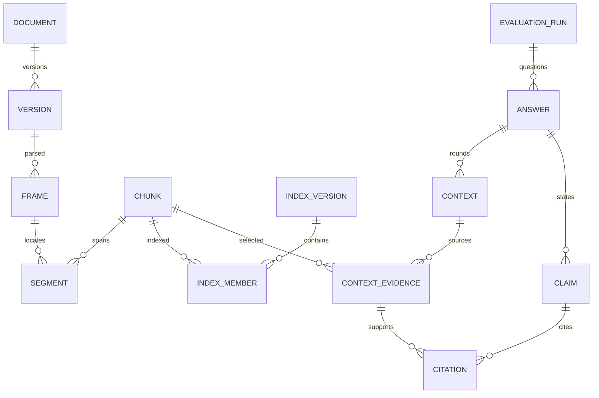

# 数据库与迁移设计

状态：逻辑设计，尚未创建数据表或执行迁移。统一使用 PostgreSQL，新增实体使用 UUID、timestamptz UTC；页面按北京时间显示。旧表整数主键保留，新增 FK 与旧 ID 类型一致。以下省略常规 created_at/updated_at，但不省略版本和来源语义。

## 数据链与约束

图中 CONTEXT_EVIDENCE 是进入上下文的证据，不代表正文必然引用或语义支持。

## 实体与关键字段

| 实体/拟表名 | 关键字段 | 约束和用途 |
| --- | --- | --- |
| 既有 t_company | id、stock_code、stock_name、industry、market | 股票代码作为字符串，保留前导0；规范化代码唯一 |
| t_document | id、corpus_type、company_id?、report_year?、title、issuer? | corpus_type 为 annual_report/regulation；年报必须绑定公司年度；法规无需公司 |
| t_document_version | id、document_id、version_label、storage_key、file_sha256、source_format、source_url?、identity_status、publication_date?、effective_from?、effective_to_exclusive?、interval_end_status、metadata_as_of_date? | UNIQUE(document_id,file_sha256)；日期未知可空；失效上界半开区间；原文件不可变 |
| t_parse_run | id、document_version_id、parser_name/version、config_hash、status、page_scope、error_code? | 一个文件版本可有多次解析；done/partial/failed 分开；OCR来源不能覆盖原件 |
| t_text_frame | id、parse_run_id、frame_kind、physical_page_1based?、text、text_sha256、text_origin、review_status | PDF 每页一个基准帧；DOCX/TXT 使用明确命名的正文帧；页码从1开始，不伪造印刷页码 |
| t_document_chunk | id、parse_run_id、external_chunk_id、content、content_sha256、dimension_tags、clause_label?、locator_status | UNIQUE(parse_run_id,external_chunk_id)；不凭标题前缀生成融合身份 |
| t_chunk_segment | id、chunk_id、frame_id、ordinal、char_start、char_end、quoted_text_sha256 | UNIQUE(chunk_id,ordinal)；0起点半开字符区间；一个跨页片段多行定位 |
| t_index_version | id、backend、manifest_key、manifest_sha256、encoder_identity、chunking_config、retrieval_config、status、parent_id? | ready 后不可改；身份包含模型revision、维度、dtype、归一化及查询指令；后端不同必须建新版本 |
| t_index_member | index_version_id、chunk_id、backend_entry_id | 复合主键(index_version_id,chunk_id)，每个检索结果能回到业务片段 |
| t_job | id、kind、status、payload、parent_job_id?、idempotency_key、progress、attempt_count、lease_owner/until、heartbeat_at、cancel_requested、error_code? | 任务幂等键唯一；领取与实际工作分事务；状态变更需条件更新 |
| t_evaluation_run | id、company_id、report_year、mode、index_version_id、index_result_id?、question_set_version、config_snapshot、config_sha256、status、parent_run_id?、job_id | 原始配置脱敏且不可变；一个运行只绑定一个索引版本；重跑产生新运行 |
| t_evaluation_answer | id、run_id、question_key、dimension、question_text、declared_target_date?、target_date_role?、status、answer_text、limitations、final_context_id?、structured_output、validation_status | UNIQUE(run_id,question_key)；四维各题单独成功/失败/资料不足；final_context_id 必须属于该 answer |
| t_context_snapshot | id、answer_id、round_no、context_text、context_sha256、reference_token_count、tokenizer_identity、candidate_trace_key、omission_log、source_records_sha256 | UNIQUE(answer_id,round_no)；候选与省略原因指向受控制品，实际输入快照不可变 |
| t_context_evidence | id、context_id、chunk_id、evidence_label、rank、source_role、retrieval_scores、locator_snapshot、text_snapshot | UNIQUE(context_id,evidence_label)，label 如 A1/R1；重排/融合/原始分数分别保存；坐标快照保留文件版本和文本帧哈希 |
| t_claim | id、answer_id、ordinal、text、answer_char_start/end、claim_type、model_support_status、guard_issues、human_review_status | 来源角色为 company_fact/normative_rule/evaluation/limitation/unknown；模型支持和人工复核不共用字段 |
| t_claim_citation | claim_id、context_evidence_id、relation、review_note? | 复合主键；必须属于 answer 的最终上下文；不允许引用其他题目或其他轮次的同名标签 |
| t_model_call | id、answer_id?、job_id、context_id?、stage、attempt、requested_model、returned_model?、provider_request_id?、prompt_key/hash、response_key/hash、usage、latency_ms、outcome、estimated_cost? | 每次真实请求都记录；价格未知 cost=null；失败和 unknown_outcome 仍保存，日志不含鉴权头 |
| t_export_artifact | id、run_id、format、storage_key、sha256、template_version、status、job_id | 导出绑定具体运行与模板版本，不随最新评价改变 |

候选追踪制品包含被召回但未进入上下文的片段、排序与过滤/预算省略原因。t_context_evidence 仅包含实际输入模型的证据。t_model_call 保存每阶段实际 prompt 与响应的引用，不能以模板版本代替实际请求。

## 定位和来源完整性

写入 t_chunk_segment 时验证 frame.text[start:end] 的哈希。跨页拼接分隔符不属于原文，在片段元数据显式记录；OCR 框坐标可放定位 JSON，但必须标明未独立核实状态。未知物理页不能填0或猜测页码。

源文件、解析、索引、评价形成不可变链。移除文件采用归档/停用，不级联删除已被评价引用的版本、片段和上下文。原件不可用时返回 source_unavailable，保留历史文本快照并显示状态。

法规版本登记不等于法律适用认证。结束日期未知与无限有效不同，由 interval_end_status 明确区分；事项日期未知时，模型和 UI 均不得用报告年度自动补齐。

## 一致性和索引

- 关系主键与外键由数据库保证；跨表的 frame/parse/version 相容性、最终上下文与引用同属 answer，由领域事务校验，迁移时增加可行的复合 FK。
- 常用索引：document(company_id,report_year,corpus_type)、job(status,lease_until,created_at)、run(company_id,report_year,created_at DESC)、answer(run_id,dimension)、model_call(job_id,stage,attempt)。
- 索引构建先 staging、校验原件/模型/片段清单，再原子激活为 ready；失败不影响旧 ready 索引。
- 新评价只能使用 ready 索引。创建任务即冻结索引版本，处理中禁止自动切换“最新”索引。
- 候选、上下文及响应制品先写临时键，校验后以不可变键登记；失败临时制品可单独清理。

## 第三章延后接入

保留既有 t_index_result 等表；本轮不迁移其数值。接入时增加结果来源、方法版本、数据集/权重版本、导入批次及唯一约束。t_evaluation_run.index_result_id 当前可为空。

日后按公司年度及明确版本选择指数，禁止以“最新结果”悄悄改变已导出报告。模型文本输出中的评分如保留，仅存 structured_output，标为模型辅助分，不能写入 t_index_result。

## 迁移顺序

1. 引入 Alembic，盘点旧库并建立备份和基线版本。
2. 增加文档、解析、定位、索引表；不删除旧年报和知识表。
3. 旧条目迁移为 legacy 来源。原文件可读时计算真实哈希；没有原件时不造哈希，保留在旧表及迁移异常清单，不能进入新 ready 索引。
4. 历史文本缺页码、版本或原文区间时标记 unknown；由原文件重新解析后建立新的可定位版本。禁止把历史标题引用自动升级为已核实引用。
5. 增加任务、运行、上下文、调用与导出表；历史评价通过只读 legacy 视图保留。
6. 在测试库演练 upgrade、重复运行、故障恢复和备份恢复，核对数量与引用完整性后切换 API。

外部文件恢复必须和数据库恢复到相容快照；数据库回滚并不会自动还原原文件与索引。此处只规定迁移方案，本轮未执行。
